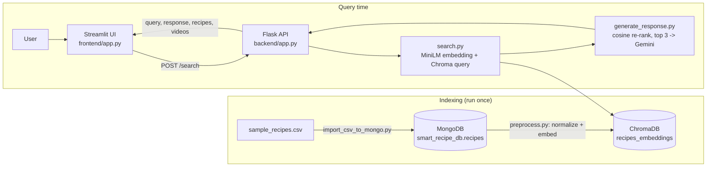

# Smart Recipe Finder

Semantic recipe search: describe what you want to cook in plain text and get the closest recipes from a vector index, plus a short LLM-written recommendation.

## Problem

Keyword search on recipe collections matches words, not intent. This project embeds recipes and free-text queries into the same vector space (sentence-transformers + ChromaDB), so a query like "chicken soup" retrieves recipes by semantic similarity. A Gemini model then compares the top results in a short answer.

## Features

- Semantic search over recipes stored in a persistent ChromaDB collection (`backend/search.py`).
- `POST /search` JSON API (Flask) with input schema validation, per-IP rate limiting (10 requests/minute on `/search`) and JSON error responses (`backend/app.py`).
- LLM recommendation: Gemini receives the top 3 recipes and writes a comparison of about 200 words (`backend/generate_response.py`). If the call fails or no key is set, the API still returns the recipes with a fallback message.
- Streamlit UI that shows the AI suggestion, recipe cards (title, ingredients) and numbered directions in expandable sections (`frontend/app.py`). The UI text is in French.
- Data pipeline: CSV import into MongoDB, then text normalization, embedding and batch indexing into ChromaDB (`backend/import_csv_to_mongo.py`, `backend/preprocess.py`).

## Architecture



## Tech stack

| Area | Technology |
|---|---|
| Language | Python |
| API | Flask, Flask-Limiter, marshmallow, python-dotenv |
| UI | Streamlit, requests |
| Document store | MongoDB (pymongo), database `smart_recipe_db`, collection `recipes` |
| Vector store | ChromaDB (persistent), collection `recipes_embeddings` |
| Embeddings | `sentence-transformers/all-MiniLM-L6-v2` |
| LLM | Google Gemini `models/gemini-1.5-flash` via `google-generativeai` |
| Similarity | scikit-learn `cosine_similarity` |

## Installation

Prerequisites: Python 3.12 (the version used for verification), and a MongoDB server reachable at `MONGO_URI` (only needed for the import and indexing steps). Run all backend commands from the `backend/` directory, because the default Chroma path is `./chroma_db`.

### 1. Backend dependencies

```bash
cd backend
python -m venv .venv
# Windows: .venv\Scripts\activate    macOS/Linux: source .venv/bin/activate
pip install -r requirements.txt
```

The first run downloads the embedding model from Hugging Face.

### 2. Environment variables

Set them in your shell or in a `.env` file (loaded with python-dotenv). Names only; supply your own values.

| Variable | Used by | Purpose | Default |
|---|---|---|---|
| `GOOGLE_API_KEY` | backend | Gemini API key (optional: without it the answer text is a fallback message) | none |
| `MONGO_URI` | import + indexing scripts | MongoDB connection string | `mongodb://localhost:27017/` |
| `CHROMA_DB_PATH` | backend + indexing | ChromaDB storage directory | `./chroma_db` |
| `PORT` | backend | API port | `5000` |
| `CSV_PATH` | import script | CSV location (a command-line argument takes precedence) | `sample_recipes.csv` at repo root |
| `RECIPE_LIMIT` | indexing | max recipes read from MongoDB | `5000` |
| `BATCH_SIZE` | indexing | indexing batch size | `100` |
| `BACKEND_URL` | frontend | full URL of the search endpoint | `http://127.0.0.1:5000/search` |

### 3. Load and index the data

```bash
python import_csv_to_mongo.py            # or: python import_csv_to_mongo.py path/to/recipes.csv
python preprocess.py
```

Note: the import script empties the `recipes` collection before inserting.

### 4. Start the API

```bash
python app.py
```

### 5. Start the UI (second terminal, separate environment recommended)

```bash
cd frontend
python -m venv .venv
# Windows: .venv\Scripts\activate    macOS/Linux: source .venv/bin/activate
pip install -r requirements.txt
streamlit run app.py
```

## Usage example

```bash
curl -X POST http://127.0.0.1:5000/search \
  -H "Content-Type: application/json" \
  -d '{"query": "chicken soup", "top_k": 3}'
```

Response shape:

```json
{
  "query": "chicken soup",
  "response": "<Gemini text, or a fallback message>",
  "recipes": [
    { "id": "recipe_0", "title": "...", "ingredients": "...", "directions": "..." }
  ],
  "videos": { "recipe_0": "https://www.youtube.com/watch?v=recipe_0" }
}
```

`top_k` is optional (default 5). In the UI, type a request and click the button.

## Project structure

```
backend/
  app.py                  Flask API (POST /search)
  search.py               query embedding + ChromaDB lookup
  generate_response.py    prompt building + Gemini call
  import_csv_to_mongo.py  CSV -> MongoDB
  preprocess.py           MongoDB -> normalize -> embed -> ChromaDB
  requirements.txt
frontend/
  app.py                  Streamlit UI
  requirements.txt
  .streamlit/config.toml  theme
  assets/                 images (not referenced by the code)
sample_recipes.csv        recipe data (title, ingredients, directions, link, source, NER)
```

## Known limitations

- **Video links are fake.** They are placeholders of the form `https://www.youtube.com/watch?v=<id>`, and since indexed recipes carry no `id`, they become `recipe_0`, `recipe_1`, ... which point to no real video. The `link` column of the CSV is imported but never used.
- **Input validation is incomplete.** With marshmallow 4.x (the pinned version), the lambda validators in `SearchSchema` do not reject a blank `query` or `top_k: 0`; both currently return HTTP 500 instead of 400. A missing `query` correctly returns 400.
- **MongoDB is required for the import and indexing steps.** The API itself only needs the ChromaDB index. In the verification environment no MongoDB server was available, so `import_csv_to_mongo.py` and `preprocess.py` were not run end to end; the search API and UI were verified against a small ChromaDB index built with the same logic.
- **No automated tests** and no CI.
- **Importer drops rows.** Replaying the importer's parsing logic on `sample_recipes.csv` accepts 3,409 of its 5,000 data rows; the rest are skipped.
- **Gemini is untested here.** Generation requires `GOOGLE_API_KEY`; the hard-coded model name `models/gemini-1.5-flash` was not tested against the live API.
- No relevance evaluation exists: result quality has not been measured.
- Recipe and LLM text is injected into HTML with `unsafe_allow_html=True` in the UI.
- The API logs the full content of every retrieved recipe at INFO level.
- Re-running `preprocess.py` adds entries to the existing Chroma collection without clearing it.
- The Chroma distance metric is not set in the code, so ChromaDB's default applies.

## Possible improvements

- Fix request validation (raise `ValidationError` in validators) and return 400 for bad input.
- Use real recipe links (the CSV `link` field) instead of placeholder video URLs, and store the recipe id in Chroma metadata.
- Add tests (API, parsing, indexing) and a small retrieval evaluation set.
- Make the importer robust to the CSV format instead of a single regular expression.
- Make the Gemini model name configurable, and escape content before rendering HTML.

## Author and license

Repository owner and committer: Fahd Chaib ([@Fahd-Chaib](https://github.com/Fahd-Chaib)). No license file is present in this repository.
